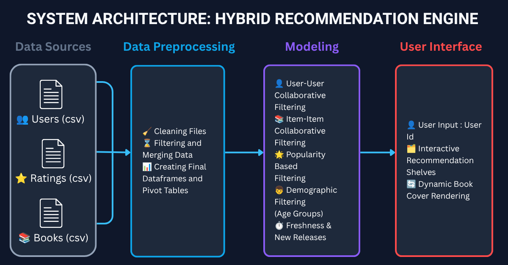

# NextRead Analytics: Hybrid Book Recommendation Engine 📚

NextRead Analytics is a full-stack, web-based recommendation system that moves complex data science modeling out of static development environments and into a live, interactive production application. Built using Flask and Pandas, the engine serves multi-layered, personalized book suggestions in real-time based on hybrid filtering methodologies.


---

## 🚀 Key Features & Architecture

Unlike basic recommendation scripts that return a single linear list, NextRead Analytics processes data through a tiered pipeline to generate distinct, strategically segmented recommendation "shelves" as seen in the application:

* 👥 **Collaborative Filtering ("Users Like You Also Read"):** Computes user-to-user vector similarities over high-dimensional sparse matrices to map user preferences accurately based on historical interaction data.
* 📖 **Content-Based Filtering ("Because You Like"):** Evaluates item-to-item vector similarities using book metadata features, recommending items with high thematic or categorical alignment to the user's history.
* 📊 **Demographic Filtering ("Popular Among Your Age Group"):** Leveraged to segment users by age metadata, serving targeted trending items within specific cohorts to mitigate the cold-start problem.
* 🌟 **Popular Choices:** Analyzes global interaction logs and rating frequencies to calculate an objective popularity baseline tier.
* ⏳ **Latest Release:** Implements a publication-year sort filter to highlight newly published titles dynamically.
* ⚡ **Real-Time Inference Layer:** A lightweight Flask backend routes user inputs, calculates vector similarities on demand, and instantly updates the glassmorphic user interface.



---

## 🛠️ Tech Stack & Tools

* **Core Language:** Python (Object-Oriented Programming)
* **Data Manipulation:** Pandas, Sklearn
* **Backend Framework:** Flask (WSGI Web Server Application)
* **Frontend UI:** HTML5, CSS3 (Custom responsive layout with dynamic loading mechanics)

---
## 📂 Repository Structure
```
├── Data_Preparation
    ├── Dataset                      # Folder to store donloaded datasets
    ├── dataset_prep.py              # Model Building Script
├── models                           # Folder to store models 
├── static
    ├── images
        ├── Generic-book-cover.png   # A generic book cover for missing images
    ├── styling
        ├── style.css                # CSS file for home page
        ├── result-page-styling      # CSS file for Recommendation page
├── templates
    ├── index.html                   # Home Page
    ├── result_page.html             # Recommendations result page
├── app.py                           # Main server logic
├── recommendation_system.py         # Recommendation System Logic
├── requirements.txt                 # Project dependecies
├── ReadME.md                        # Documentation
```

## ⚙️ Local Installation & Setup
To run this project locally, clone the repository and install the required dependencies:

### Clone the repository
```
git clone https://github.com/Satviki-2003/Book-Recommendation-System/tree/main/NextRead-Analytics
```

### Navigate into the project directory
```
cd NextRead-Analytics
```

### Install dependencies
```
pip install -r requirements.txt
```

### Download Dataset
Download [Book Recommendation Dataset](https://www.kaggle.com/datasets/saurabhbagchi/books-dataset)

### Model Preparation
Upload datasets into Dataset folder as separate files. 
Then run:
```
cd Data_Preparation
python dataset_prep.py
```


### Run the Flask development server
```
cd ..
python app.py
```
Once the server initializes, open your browser and navigate to http://127.0.0.1:5000/.
